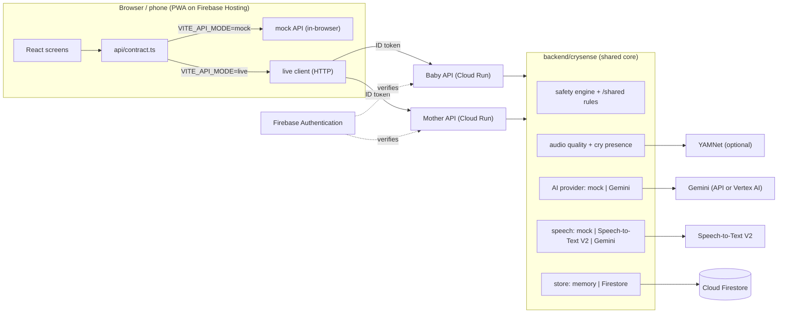

# Architecture

CrySense is a React PWA that talks to two independently deployed, independently authorised Cloud Run services. Every external dependency sits behind a provider interface with a mock, so the whole system runs offline for development and demos, and switches to Google services by environment variable.

## System diagram

## Two services, one image

Both APIs are built from `backend/Dockerfile`. The `SERVICE` variable picks the app (`baby_api.main:app` or `mother_api.main:app`). In production each runs with its **own service account**, so a compromise of one does not grant the other's permissions.

| Service | Owns | Who may call |
|---|---|---|
| Baby API | `infantRecords/*`, infant consents, `/v1/me`, `/v1/support` | Any caregiver listed in `caregiverUids` |
| Mother API | `maternalRecords/*`, mother consents, questionnaire, care summaries | Only the record's `ownerUid` |

Authorisation is checked in code on every request (`crysense/auth.py`):

- `require_infant_access` returns **404** for non-caregivers, so ids cannot be probed.
- `require_mother_owner` returns **403**. A household member, even the partner, cannot open maternal records.

Cross-service features (partner nudges written by the Mother API and read by the Baby API) work through the shared data store. Locally, `backend/dev_combined.py` serves both apps from one process so they share the in-memory store; separate processes need `DATA_STORE=firestore` or the emulator.

Firestore rules (`firebase/firestore.rules`) deny all direct browser access. They include narrow read rules mirroring the same logic as defence in depth.

## Provider toggles

| Concern | Interface | Mock | Google implementation | File |
|---|---|---|---|---|
| Storage | `DocumentStore` (get/set/delete/list) | `MemoryStore`, seeded | `FirestoreStore` | `crysense/store/` |
| Structured AI | `extract_event`, `reflect` | rule-based `MockProvider` | `GeminiProvider` with `response_schema` | `crysense/ai/` |
| Speech | `transcribe()` | fixed sample transcript; typed text always wins | Speech-to-Text V2 `recognize`, or Gemini audio | `crysense/speech/` |
| Cry presence | `detect(samples, rate, quality)` | transparent energy heuristic | YAMNet AudioSet class | `crysense/audio/cry_presence.py` |
| Identity | `get_principal` | `mock-<uid>` tokens | Firebase Admin `verify_id_token` | `crysense/auth.py` |

Store paths mirror Firestore exactly (`infantRecords/inf_anya/events/evt_1`), so moving from memory to Firestore needs no code changes.

## The deterministic layer

Generative output never decides anything on its own.

| Step | AI may | Code always |
|---|---|---|
| Voice log | propose type, amount, time | validates units and ranges, rejects future times, marks assumed fields, waits for a person to confirm |
| Journal reflection | write a short summary of what she said | blocks clinical labels (`ai/guards.py`), forces `medicalAssessment: false`, requires her review |
| Warning signs | nothing | evaluates versioned JSON rules; emergency outranks everything |
| Questionnaire | nothing | scores from the instrument JSON; safety item routes to support |
| Medicines | nothing | schedules only from her entry; `extra="forbid"` rejects any dose field on events |

## Shared, reviewable content

`/shared` is the single source of truth for safety rules, the questionnaire and support contacts. The backend reads it at runtime (`SHARED_DIR`); the frontend imports the same files at build time for the mock API and the offline Help screen. A clinician reviews content files, not code.

## Frontend structure

- `api/contract.ts` defines the whole client surface. Screens never know whether they talk to the mock or to Cloud Run.
- `api/mock/` ports the backend logic to TypeScript (`logic.ts`) and keeps documents in memory with best-effort `localStorage` persistence.
- `state/session.tsx` holds identity and builds the right API. In live mode it calls `/v1/me` so the client never guesses record ids.
- Help is bundled into the app, so it works before sign-in and without a network.
- Audio is recorded as 16 kHz mono WAV (`lib/recorder.ts`), so the same bytes work for quality checks, Speech-to-Text and Gemini.

## Security and privacy controls

| Control | Where |
|---|---|
| Per-request authentication | `get_principal`: Firebase ID token, revocation checked |
| Record-level authorisation | `require_infant_access`, `require_mother_owner` |
| Consent per purpose, server-enforced | `api_common.require_consent` returns `403 consent_required` |
| Raw audio never stored | audio is decoded in memory; analyses store metrics only (`rawAudioRetained: false`) |
| Redacted logs | `logging_utils.py` logs route template, status and latency only |
| Audit trail | `auditEvents/*` for consent changes, exports, deletions, shares (no content) |
| Deletion | `DELETE /data` removes every collection for the subject and reports counts |
| Secrets server-side | Gemini keys and service accounts live in Cloud Run, never in the browser |
| Browser hardening | Hosting headers: `nosniff`, `Permissions-Policy: microphone=(self)` |

## Testing

`backend/tests` (35 tests, about 1 second):

| File | What it proves |
|---|---|
| `test_separation.py` | Partner can read baby, not mother; strangers get nothing; Help is public; `/v1/me` lists only permitted ids |
| `test_audio.py` | Silence, short, clipped, noisy and corrupt files are flagged; no cause is ever returned; audio not retained |
| `test_baseline.py` | Missing days are not zero; averages use logged days only; feed gap median |
| `test_safety.py` | Emergency outranks all; fever rule depends on age; parent concern always escalates; support shown, nobody contacted |
| `test_mother_flows.py` | Deterministic scoring and skips; safety item; dose cannot be changed; journal review, save, delete; reflection guard; sharing needs consent |
| `test_modules.py` | Record validation and upserts; partner cannot read her modules; vaccine status by date; partner nudge only when enabled and only fixed text; share link expires (410); observations are questions |
| `test_voice_log.py` | Extraction with provenance; assumed time flagged; non-events rejected; invalid values rejected; revoked consent blocks AI |

Frontend: `npm run typecheck` and `npm run build`. For Firestore rules, run the Firebase emulator (`firebase emulators:start`) and add rules tests before storing real data.
