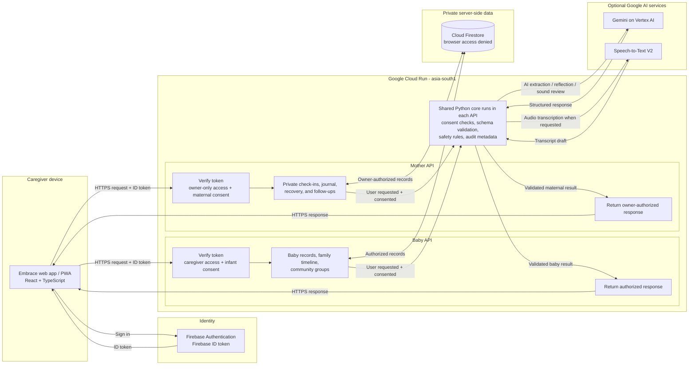

# Embrace | AI Builder Cup

**Story:** A parent is up in the night trying to remember what happened and what to do next. Embrace connects baby care, postpartum care, and family support in one place, with AI that explains its limits. The product could gain an optional Google Nest interface later; that is a roadmap item, not a current feature.

**Deck guidance:** Use the story-led copy directly on the slides. Keep slide 6's existing wireframe and slide 10's existing prototype snapshots. The team leader's name was not provided, so that field remains a placeholder. Slide 11 is a benchmark plan, not a report of results; complete it after running the separate evaluation.

## Slide 1 | Team and Problem

**On slide**

- **Project:** Embrace | *Care for baby. Space for you.*
- **Team:** Embrace
- **Team leader:** [Name]
- **Team members:** [Names]
- **The problem:** In the middle of a tiring day or night, families must piece together care details scattered across notes, apps, and conversations, while the mother's own recovery can disappear from view.

## Slide 2 | Brief About the Idea

**On slide**

- **At 2:13 a.m., one more question can feel overwhelming:** When was the last feed? When was the diaper? What is coming up tomorrow?
- Embrace brings a baby's everyday care and a mother's postpartum wellbeing into one family companion.
- Keep feeds, sleep, diapers, milestones, vaccines, and follow-ups in a family timeline.
- Give the mother a separate private space for check-ins, recovery, journaling, and support.
- **Emi** helps organize information and offer bounded, non-diagnostic guidance when invited.
- Connect parents through joinable peer groups.
- **Embrace does not guess why a baby is crying; it helps the parent see what is known, choose a practical next step, and find support.**

## Slide 3 | Opportunities

**On slide**

- **The opportunity is not another feed counter; it is continuity across family care.**
- Unify recurring care, appointments, and milestones in one place.
- **Support the whole family:** include postpartum recovery and caregiver wellbeing, not only baby tracking.
- **Make AI practical and accountable:** use it for reviewed drafts, summaries, and observable sound descriptions, with clear limits.
- **Strengthen peer support:** small groups for questions, lived experience, and everyday challenges.
- **Extend access over time:** explore voice-first and household-device access after validating safety, privacy, and user need.

## Slide 4 | Features Offered by the Solution

**On slide**

**From the baby's everyday routine to the mother's recovery, Embrace connects practical family care.**

- **Baby care:** tap or voice-log feeds, sleep, and diapers; see since-last summaries, recent events, baby-specific timelines, and weekly patterns. Use on-device soothing sounds, timers, and “what helped” notes; optionally request a consented sound review with observations, not a cause diagnosis.
- **Baby health:** track growth, regional vaccine schedules, and photo milestones; prepare doctor-visit questions and printable summaries; record visit notes and follow-up dates.
- **Mother's space:** skippable mood, energy, rest, pain, and support check-ins; recovery logs and warning signs; hydration and daily wins; nutrition and lactation resources; follow-ups and clinician-instructed medicine reminders. Keep a voice or written journal with transcript review and optional Emi reflection, plus a separate session-only Emi conversation.
- **Family support and control:** manage multiple babies; optionally send a fixed partner nudge; join peer groups to post, reply, report, or block; preview and share selected care summaries for a limited time. Consent/privacy settings, export/delete controls, help contacts, voice-language choice, night/red-light themes, and one-handed quick-log controls keep care personal and accessible.
- **Caregiver stays in control:** relevant AI actions require consent, drafts are reviewed before saving, maternal records remain private, and logs are not silently shared. Emi is not a clinician or therapist.

**Prototype qualifications:** the wellbeing questionnaire is a placeholder pending an approved instrument; demo summary delivery is a stub. Vaccine schedule verification and clinical review remain outstanding.

## Slide 5 | Process Flow / Use Case

**On slide**

```text
Caregiver chooses a task
       |
       +--> Quick log --> Review details --> Save to selected baby's timeline
       |
       +--> Optional sound check --> Grant consent --> Submit short clip
       |                              + selected baby's recent care context
       |                         --> Emi describes observable features
       |                         --> Caregiver reviews non-diagnostic checks
       |
       +--> Need personal support? --> Private journal or Emi conversation
       |
       +--> Need peer support? --> Join group --> Post --> Receive replies
```

- The caregiver initiates each AI action and chooses what to share.
- AI-assisted log drafts require review before they are saved.
- Sound review uses the selected baby's limited recent care context; raw audio is not retained by the review service.
- Community posts are peer experiences, not clinical advice.
- **The caregiver starts every path; Embrace does not monitor the room in the background.**

## Slide 6 | Wireframe

**Use the wireframe already in the deck.** Keep its current screens and label the relevant areas with these short captions if space allows:

- **Today:** selected baby's care at a glance.
- **Quick log:** record a routine without navigating through multiple screens.
- **Review before save:** caregiver checks AI-assisted details.
- **Baby sound check:** observations and limits are visible together.
- **My space:** the mother's care is distinct and private.
- **Community:** group threads and replies are peer-to-peer.
- **Together, the screens answer “what happened?”, make the next action easy, and keep private reflection separate from baby-care records.**

## Slide 7 | Architecture Diagram

**On slide**

**A caregiver-initiated request passes through identity, access, and consent checks before it reaches family data or an AI provider.**



- **Privacy boundary:** baby/community access follows caregiver membership; maternal records are owner-only. The browser cannot query Firestore directly.
- **AI boundary:** services check consent, validate outputs, and return drafts or observations for caregiver review; they do not silently save AI-generated care records.
- **Audio boundary:** recordings are sent only for the requested task and raw sound-review audio is not retained.
- **Operations:** API credentials stay server-side; audit metadata is retained without logging journal text or audio content.

## Slide 8 | Technologies to Be Used

**On slide**

**The prototype already uses this Google-centered stack, with authentication and consent checks before server-side AI or speech requests.**

| Layer | Technology |
|---|---|
| Web client | React, TypeScript, Vite; installable responsive web app |
| Authentication | Firebase Authentication |
| API | Python, FastAPI, Pydantic |
| Data | Cloud Firestore |
| Compute and hosting | Google Cloud Run; Firebase Hosting |
| Generative AI | Gemini through server-side Google Cloud integration |
| Speech | Google Speech-to-Text for user-requested transcription |
| Quality | Pytest, TypeScript checks, browser workflow tests, API monitoring |

## Slide 9 | Estimated Implementation Cost

**On slide**

**We already have the working product. Budget for pilot hardening, not another full build.**

- **Already built:** web app, APIs, sign-in, Firestore, Gemini features, and community flows.
- **Remaining work:** about 70–105 hours for release review, targeted fixes, accessibility, privacy checks, benchmarking, and handoff.
- **Lean one-time budget:** **₹1.0–₹2.3 lakh**, including a 20% contingency and reuse of the current product.
- **Agency option:** about **₹1.9–₹5.6 lakh** for the same scope, based on Clutch's India agency band and an illustrative ₹90/US$ conversion.
- **Monthly usage examples:** 10,000 short Gemini text requests, about **$75**; 1,000 Speech-to-Text V2 minutes, about **$16**. Cloud Run/Firestore may fit free quotas at pilot scale.
- **Not included:** audio-heavy AI, SMS, tax, clinical/legal review, certification, and ongoing moderation/support.

## Slide 10 | Prototype Snapshots

**Use the snapshots already added. Together they show the caregiver journey from seeing family context to reviewing a draft and choosing a next step.** Add a short caption to each image, matching it to what the screenshot actually shows:

- **Family home:** selected baby and quick access to the care timeline.
- **Care record:** caregiver reviews a draft before saving.
- **Emi sound check:** observable listening notes and non-diagnostic checks.
- **Mother's space:** private journal, recovery, or support conversation.
- **Community:** joinable group discussion and replies, presented as peer support rather than clinical consultation.
- Show only what the current prototype actually demonstrates; make caregiver choice and review visible.

## Slide 11 | Prototype Performance / Benchmarking

**Status: separate benchmark still to be run. Do not present targets below as measured results.**

**On slide**

| Measure | Evaluation method | Result |
|---|---|---|
| Core API latency and error rate | Repeat authenticated requests; report p50/p95 and 4xx/5xx | To be measured |
| AI response latency and availability | Repeated consented test requests by task; report p50/p95, timeouts, and provider errors | To be measured |
| Draft field correctness | Blinded review against a labeled synthetic/test set; report field-level precision/recall and correction rate | To be measured |
| Sound-note validity | Check timestamps stay within clip; review enum validity and annotator agreement | To be measured |
| Load behavior | Step concurrent test users while tracking latency, failures, and cost | To be measured |
| Privacy and access controls | Verify consent gates, account isolation, retention behavior, and audit logs | Pass/fail evidence to be recorded |

- Record build/revision, region, model, test date, dataset size, concurrency, and test environment.
- Use synthetic or explicitly consented evaluation data; do not claim clinical accuracy from a product benchmark.
- **Proposed service objective for the pilot:** report p95 latency and error rates against an agreed threshold after the baseline run; set the threshold before the load test.
- **What the benchmark can show:** system reliability and output validity under stated test conditions, not clinical accuracy or a baby's diagnosis.

## Slide 12 | Additional Details and Future Development

**On slide**

1. **Pilot and learn:** test whether families can keep useful records with less effort; gather usability and accessibility feedback.
2. **Improve quality:** complete the benchmark, strengthen multilingual support, and evaluate AI drafts against carefully labeled data.
3. **Grow family support:** refine group discovery, reporting, blocking, and moderator operations before expanding community scale.
4. **Explore Google Nest, opt-in:** investigate the supported Google Home/Nest developer surfaces and eligibility; prototype a narrow, caregiver-requested reminder or summary with explicit account linking and permissions.
5. **Keep the boundary:** no continuous nursery listening, automatic cry diagnosis, emergency detection, or replacement for clinical care.

**Next:** validate Embrace with families, strengthen quality and community operations, and only then explore a supported, caregiver-requested Nest interaction.

**Closing line:** “Embrace helps a family remember what happened, choose a sensible next step, and make room for the person doing the caring.”

## Before presenting

- Fill in the actual team leader and member names.
- Confirm slide 6's wireframe and slide 10's screenshots match the current prototype.
- Keep slide 11 labeled “to be measured” until the separate benchmark is complete.
- Keep the slide 9 assumptions visible; get a fixed-scope quote and verify usage in the Google Cloud calculator before seeking budget approval.
- Describe Nest only as a future exploration until an approved integration is built and tested.

## Cost Study Basis (Appendix, Not Slide Copy)

**Findings (accessed 18 October 2026):**

- **Scope correction:** Embrace's app, APIs, authentication, Firestore, Gemini integration, community, and core care flows are already built and deployed. The next budget should cover readiness work, not a new product build.
- **Effort:** 70–105 hours for release review, focused fixes/accessibility, privacy/access checks, benchmark, and handoff.
- **Lean budget math:** at an assumed ₹1,200–₹1,800/hour, effort costs ₹0.84–₹1.89 lakh; adding 20% contingency gives ₹1.01–₹2.27 lakh, rounded to ₹1.0–₹2.3 lakh. Team labor still has opportunity cost if no contractor invoice is paid.
- **Agency cross-check:** Clutch lists Indian vendors below $25/hour and in a $25–$49/hour band. The latter yields roughly ₹1.9–₹5.6 lakh for the same hours plus contingency at an illustrative ₹90/US$ conversion. Directory rates are not a quote or a freelancer salary survey; request a fixed-scope proposal.
- **Gemini usage example:** Google lists Gemini 3.5 Flash global rates at $1.50/M input and $9/M output tokens. A 2,000-input/500-output-token text request is about $0.0075; 10,000 are about $75 before tax. Audio, longer prompts, retries, and model changes affect the total.
- **Transcription example:** Speech-to-Text V2 standard is $0.016/minute; 1,000 processed minutes are $16 before tax.
- **Free-tier caveat:** Cloud Run request-based pricing lists 2M requests, 180,000 vCPU-seconds, and 360,000 GiB-seconds monthly (CPU/RAM allowance based on us-central1 pricing). Firestore's free quota for one database/project lists 1 GiB, 50,000 reads/day, and 20,000 writes and deletes/day. Region, billing aggregation, networking, min instances, SMS, backups, and excess usage can still create charges. Set budget alerts and verify the deployment in the calculator.
- **Excluded from this estimate:** external clinical/legal review, formal certification, SMS, tax, hardware, and ongoing moderation/support. Price these separately before public launch.

**Sources:**

- [Clutch: Software Developers in India](https://clutch.co/in/developers)
- [Google Cloud Run pricing](https://cloud.google.com/run/pricing)
- [Cloud Firestore pricing](https://cloud.google.com/firestore/pricing)
- [Vertex AI generative AI pricing](https://cloud.google.com/vertex-ai/generative-ai/pricing)
- [Speech-to-Text pricing](https://cloud.google.com/speech-to-text/pricing)
- [Google Cloud pricing calculator](https://cloud.google.com/products/calculator)