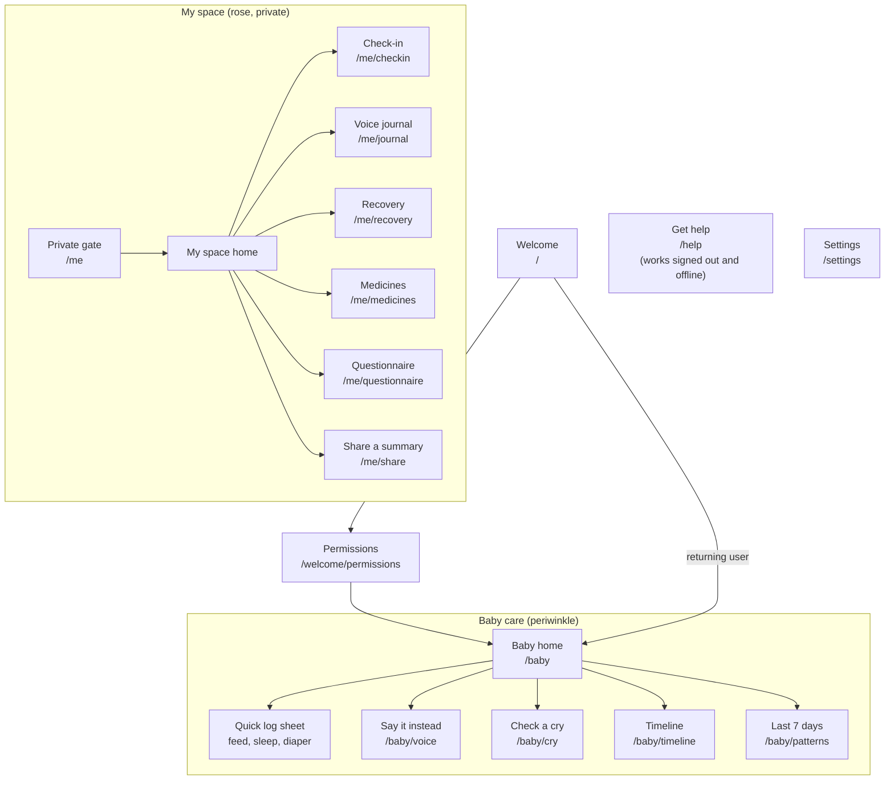
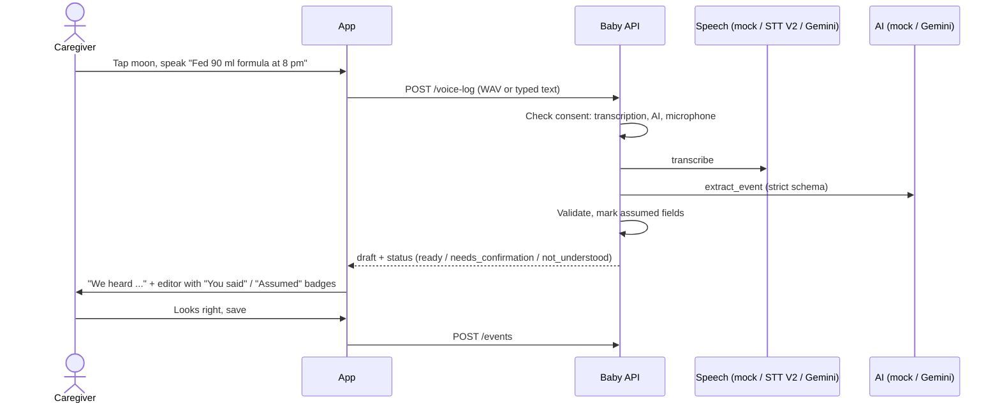
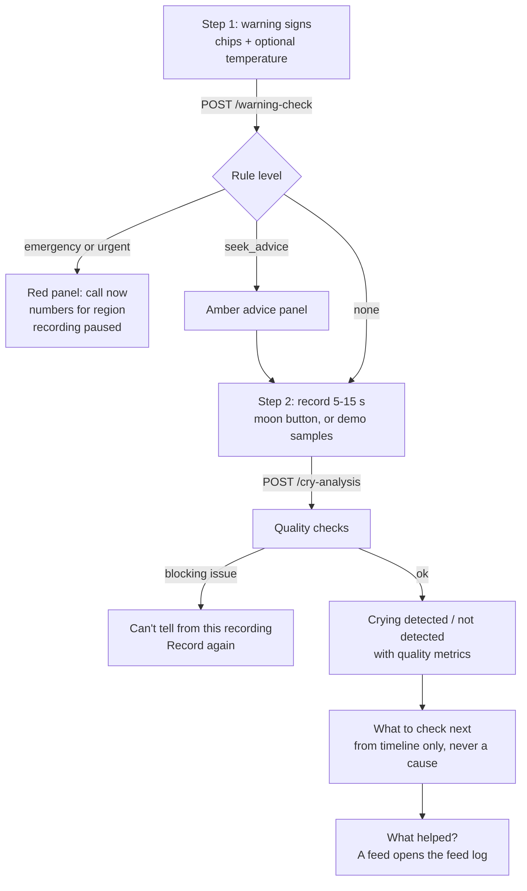
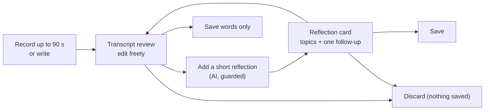
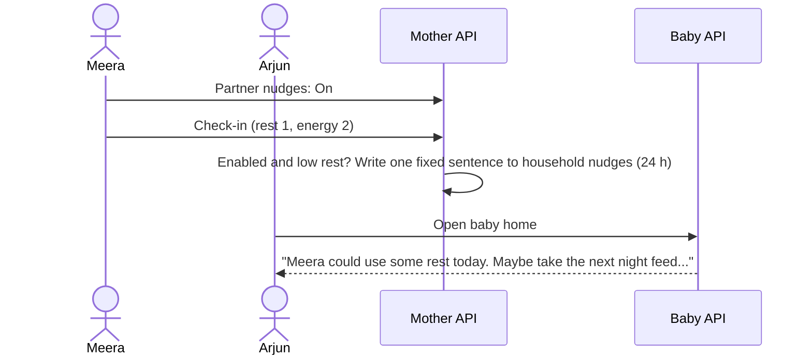

# User flows

Every flow below works in both modes: browser-only mock and live APIs. Routes use a hash router (`/#/baby/cry`), so the app works on any static host.

## Map of screens

The tab bar (Baby, My space, Help, Settings) and the **Get help** pill in the top bar are on every screen.

---

## 1. Sign in and permissions

1. **Welcome.** Demo mode shows two household members: Meera (mother) and Arjun (partner). Firebase mode shows "Continue with Google".
2. The app calls `/v1/me` to learn which records this person may open (`infantId`, `motherId`).
3. **Permissions** (first run only): six separate switches, each explained in one sentence: microphone, transcription, AI, saving entries, sharing, research. Sharing and research start off.
4. Continue goes to Baby home.

## 2. Quick log (feed, sleep, diaper)

1. Baby home shows the baby's name and age, plus "since last feed", "awake" and "since diaper".
2. Tap **Log feeding**, **Log sleep** or **Log diaper**. A glass bottom sheet opens with sensible defaults.
3. Save calls `POST /events`. The server validates (amount 1 to 400 ml, sleep end after start and under 16 h, no future times). Errors appear as a toast in plain words.

## 3. Say it instead (voice to event)

- Typing is always available (accessibility, and when the microphone is unavailable). Example phrases fill the box.
- Nothing is saved until the person confirms.
- If consent is missing, an inline card explains the purpose and offers **Allow and continue**.

## 4. Check a cry (safety first)

- Warning signs come from `shared/rules/baby_warning_signs_v1.json`. A fever of 38 °C or more is **urgent** under 90 days and **seek advice** after.
- "You feel something is seriously wrong" is always urgent. A recording can never override it.
- Demo samples cover every outcome: Clear cry (detected), Noisy room (uncertain, background), Too short, Silent room, Too close (distorted).
- The result always shows the model version and the limitations. The audio is not kept.

## 5. Timeline and edits

- Last 7 days grouped by day, filter chips (Everything, Feeds, Sleep, Diapers).
- Edit opens the same editor. Saving a correction moves the field from "assumed" to "stated" in provenance.
- Delete is in the editor.

## 6. Last 7 days (observed baseline)

- A coverage ring shows how many days have logs ("6/7 days").
- Bars per day for feeds, sleep hours or wet diapers. Days without logs are **striped and labelled "none"**, never drawn as zero.
- Averages use only complete days with logs. The note says plainly: it describes what was logged, not a medical norm.

## 7. My space: privacy gate

- **Arjun** (partner): sees "This space is private". The API returns 403 regardless of the UI.
- **Meera**: a passcode keypad (demo accepts any four digits; production should use the device lock through WebAuthn).
- Unlocking lasts for the session only.

## 8. Daily check-in

- Five scales: mood, energy, rest (1 to 5), pain (0 to 10), feeling supported (1 to 5). Each has **Prefer not to answer**.
- Pain of 7 or more suggests opening Recovery and the warning-sign check. It never diagnoses.

## 9. Voice journal

- The reflection is written only from her reviewed words. A deterministic guard replaces any clinical label ("depression", "disorder", "risk score") with a neutral line.
- Saved entries list shows the reflection or the first words, each with delete.

## 10. Recovery

- **Check warning signs**: heavy bleeding, chest pain or breathlessness, severe headache or vision change, one-sided leg pain, wound or breast signs, thoughts of harm, temperature.
- Results: emergency, **support now** (thoughts of harm: support lines shown immediately, nobody contacted), urgent, seek advice.
- **Log how you feel**: symptom, severity 0 to 10, better / same / worse, onset date.

## 11. Medicines

- Today's doses with Taken, Later (moves the reminder by 30 minutes) and Skip.
- Add a medicine: name, dose as written, times, dates, plus a required checkbox: "These are my clinician's instructions, entered as written."
- The API rejects any attempt to change a dose through dose events.

## 12. Questionnaire

- One question at a time, progress bar, **Prefer not to answer** on each.
- A banner states it is a placeholder until an approved instrument is licensed.
- Scoring is deterministic. Skipped questions mean no total. A positive answer on the safety item shows support lines first and states that nobody was contacted.

## 13. Share a summary

1. Choose the recipient, role, fields (check-ins, recovery, medicines, journal reflections, questionnaire) and period.
2. **Preview exactly what will be shared**: deterministic text, no AI.
3. **Share**. If sharing consent is off, the consent card appears first.
4. The share is written to the audit trail. In this prototype, delivery is a demo stub.

## 14. Help

- India emergency numbers, support lines, "If the crying is too much" guidance, and the warning signs for baby and mother.
- Bundled with the app. Reachable from every screen and before sign-in.

## 15. Settings

- Theme: night at 8 pm (automatic), always day, always night.
- Region.
- Permissions for baby care, and for My space once unlocked.
- Who can see what.
- Download data (JSON), delete baby logs, delete private records (with confirmation).
- Restore demo data.

## 16. Modular home and module library

1. Each home shows a header and a bento of enabled module widgets.
2. **Edit home** opens the library: a switch per module and "Coming next" roadmap cards.
3. Choices are saved on the device and the home updates immediately.

## 17. Partner nudge (consent-bound household support)

Arjun never sees her scores, notes or journal.

## 18. 15-minute QR share at the clinic

1. Share, choose fields, **Preview exactly what will be shared**.
2. **Show QR for 15 minutes** (sharing consent asked first if needed).
3. A countdown runs under the QR. The doctor scans and sees only those fields.
4. At zero the QR blurs and the server returns `410 Gone` for the link.

## 19. Other module flows

- **Soothe:** pick a sound (shush, white noise, soft rain, deep hum, heartbeat, lullaby), set a timer, tap what helped. The most helpful techniques rise to the top.
- **Growth:** add weight, length or head size; see the trend line.
- **Vaccines:** see doses due from the date of birth; mark each as given.
- **Milestones:** add a moment with a resized photo; it appears in the memory grid and the letter.
- **Doctor visit:** choose 7 or 14 days, add questions, print or save as PDF.
- **Follow ups:** tick appointments done; add from suggestions.
- **Letter to my baby:** milestones plus chosen wins plus her own words, printed as a keepsake.
- **One-handed mode:** a floating dock of Feed, Sleep, Diaper and Cry above the tab bar.
